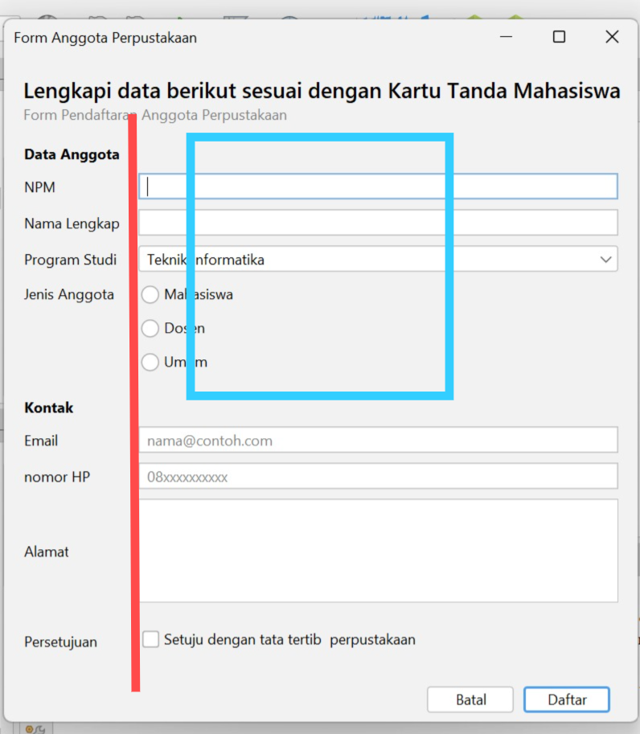
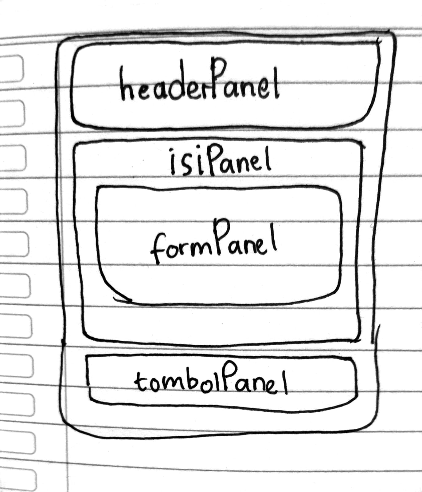
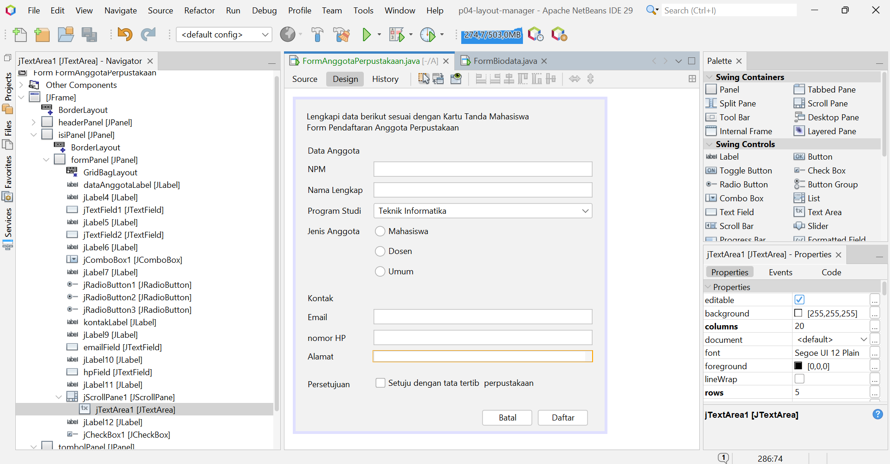

-G. Pertanyaan Refleksi 
1. Mengapa Null Layout dan Absolute Layout sebaiknya dihindari? 
2. Jelaskan perbedaan perilaku FlowLayout dan GridLayout saat jendela dilebarkan. 
3. Apa fungsi Weight X dan Fill pada constraint GridBagLayout? 
4. Mengapa formPanel dibungkus isiPanel dan diletakkan di North? 
5. Sebutkan dua prinsip desain yang Anda terapkan pada Form Anggota Perpustakaan dan tunjukkan buktinya. 

Jawaban : 
1. Karena tidak menyesuaikan jendela, teks bisa terpotong, dann Absolute Layout perlu library.

2. Perilaku FlowLayout ketika jendela dilebarkan komponen berpindah baris ke arah kanan atau berderet ke kanan sementara GridLayout ketika jendela dilebarkan sel akan tetap terbagi rata.

3. Fungsi Weight x adalah untuk pembagian sisa lebar sementara fungsi Fill adalah agar komponen memenuhi sel.

4. Agar ketika jendela ditarik keatas form mengikuti ke arah North.

5. Menggunakan 2 prinsip Keselarasan(Merah) dan Konsistensi(Biru.)

-Foto sketsa form dan tabel rancangan :

| Bagian | Panel | Layout |
| :--- | :--- | :--- |
| Jendela | JFrame | BorderLayout |
| Header | JPanel (Header Panel) | BoxLayout |
| Isi form | JPanel (Form Panel) | GridBagLayout |
| Tombol | JPanel (Button Panel) | FlowLayout |

-Dua tangkapan layar (screenshot) FormAnggotaPerpustakaan saat dijalankan: ukuran awal dan saat dilebarkan :

-Satu tangkapan layar (screenshot) tab Design FormAnggotaPerpustakaan yang memperlihatkan susunan panel dan layout di jendela Navigator :

-Jawaban eksperimen Praktikum 2 dan Praktikum 4, serta saran dari teman pada Tahap 4 : 

Eksperimen Praktikum 2 :

1. Pada flowPanel, ubah Alignment layout menjadi Center, lalu kecilkan jendela. Apa yang berubah? Baris 
mana di initComponents() yang ikut berubah? 
2. Pada gridPanel, ubah Rows menjadi 0 dan Columns menjadi 2. Berapa baris yang terbentuk dan mengapa? 
3. Pada boxPanel, isi properti maximumSize keempat tombol dengan lebar 32767 dan tinggi sama dengan 
tinggi tombol. Bagaimana lebar tombol berubah? Tambahkan juga Vertical Strut dari kategori Swing Fillers di 
antara tombol.

Jawaban : 
1. barisan button berubah menjadi rata tengah begitu juga saat jendela dikecilkan. baris kode pada initComponent berubah menjadi alignment nya menjadi FlowLayout.CENTER.

2. Terbentuk 5 baris (dengan rincian 4 baris penuh masing-masing berisi 2 kolom, dan 1 baris terakhir berisi 1 tombol sisa di kolom pertama). karena button nya ada 9 otomatis grid layout menampilkan baris ekstra agar semua button 1-9 tampil.

3. Lebar tombol berubah melebar memenuhi container dan mengikuti arah layout(vertikal). dan Vertikal strut menambah jarak kosong.

Eksperimen Praktikum 4 :
1. Ubah Weight X pada namaField menjadi 0.0, lalu lebarkan jendela. Apa yang terjadi pada isian? 
2. Ubah Direction formPanel di dalam isiPanel dari North menjadi Center, lalu tinggikan jendela. Apa 
perbedaannya? 
3. Hapus baris setMinimumSize(getSize()) di konstruktor, lalu kecilkan jendela sekecil mungkin. Bagian 
mana yang rusak lebih dulu? 

Jawaban :
1. Komponen nameField saat jendela dilebarkan ikut melebar.

2. Perbedaannya terlihat saat jendela ditinggikan ketika directionnya North formPanel ikut meninggi saat jendela ditinggikan sementara ketika directionnya Center maka formPanel hanya tertinggal ditengah tidak ikut meninggi dengan headerPanel.

3. Bagian formPanel nya hilang duluan saat jendela dikecilkan sekecil mungkin.

-Deklarasi penggunaan AI: Ya, Saya menggunakan AI untuk keperluan membantu menjelaskan bagian di modul yang tidak dapat dipahami, contoh membantu menjelaskan layout2 yang digunakan didalam praktikum.
